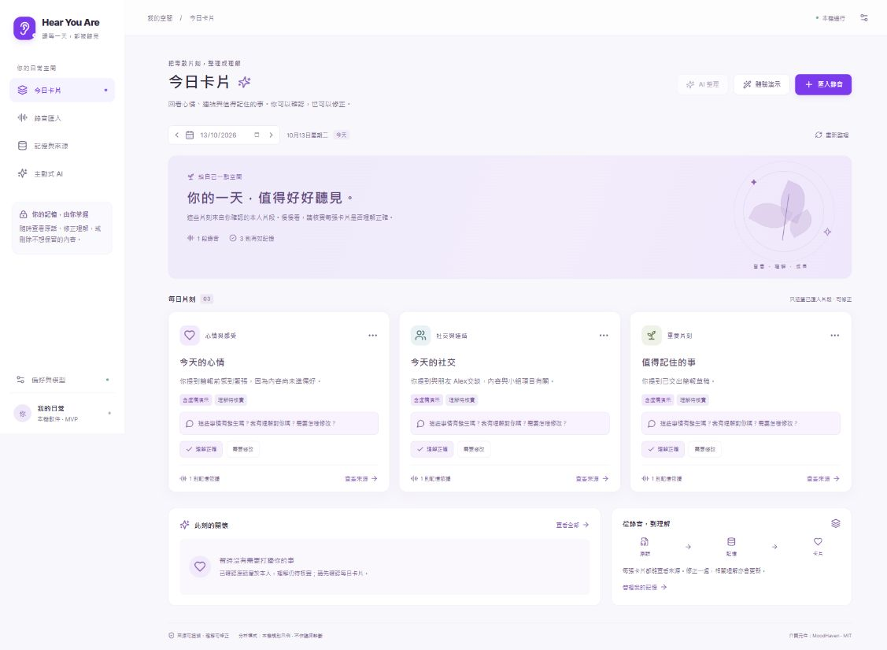
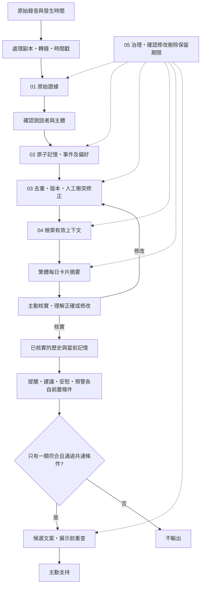

# Hear You Are · 軟件 Demo

**v0.2.0 · 2026-10-13 · Yonghan（with Codex）**

將已有錄音整理成可追溯、可修正的記憶與每日卡片。先主動核實「我有沒有理解對你」，再連結已核實的歷史與當前記錄，於條件符合時主動支持。電腦端網頁 MVP，使用 MoodHaven 的柔和紫色介面元件、Whisper large-v3-turbo＋faster-whisper，以及 PRD 五層 Memory Infra。



## 這版可以做甚麼

- 手動匯入 WAV／MP3／M4A／FLAC／OGG／WEBM／MP4，背景本機轉錄、等待／處理／完成／失敗狀態及重試。預設最大 100 MB／20 分鐘。
- 保留錄音原件、時間戳、英文原話及詞級時間；確認哪些片段屬於本人，再整理成事件或偏好記憶。
- 每日展示心情、社交及重要片刻卡片；點擊來源後回放原音、修改理解、查看版本。錄音時間未知時保留未知，記憶仍可管理，但不混入某天卡片或定時關懷。
- 每日摘要用繁體中文歸納錄音中的明確表述，並主動詢問理解是否正確。確認主體與核實理解是兩個步驟；未核實的記憶不作主動支持依據。修改後再次核實新摘要，過期版本不能被確認。
- 修正建立新版本並更新卡片；刪除記憶清除其歷史文案及衍生提示；刪除錄音一併移除片段、關聯記憶與原檔。相同檔案重複匯入不增加證據。
- 提醒、建議、安慰各有明確前置條件；零類符合、條件不明、多類符合而優先規則未定時不輸出。展示前重查來源版本、許可、免打擾及頻率。
- 連結已核實的過往與今天記錄，提供睡眠跟進、社交鼓勵或情緒支持；列出歷史和當前出處。睡眠建議可讓用戶明確選擇睡覺提醒時間，應用開啟時檢查到期事項。
- 警示只提供明確標示的虛構演示，且須單獨開啟。提供略過、延後、完成、幫助回饋；接收狀態不當成新個人事實。
- 偏好內保留專業知識／心理諮詢案例 JSONL 資料集入口：本機匯入、查看、去重、刪除，均為待專業審核；未啟動後訓練，也未投入即時心理判斷。
- 所有介面文案採香港繁體中文，原始英文逐字稿保留英文。

## 在 Windows 啟動

需要 **Python 3.11+** 及 **Node.js 20.19+／22.12+**。已在 Python 3.12、Node 24、Windows、RTX 4060 上驗證。

```powershell
git clone https://github.com/macaqueedmai-wq/Hear-You-Are---Software---Demo.git
cd Hear-You-Are---Software---Demo
python scripts/setup.py --gpu --dev
```

NVIDIA GPU 使用 `--gpu`，會安裝可選 CUDA 12 cuBLAS／cuDNN 9 函式庫。CPU 使用 `python scripts/setup.py --dev`，仍運行相同 large-v3-turbo 模型，採 INT8。

完成後雙擊 **Start-Demo.cmd**，或：

```powershell
.\.venv\Scripts\python.exe scripts/run.py --open
```

瀏覽器開啟 **http://127.0.0.1:8765**。保持終端運行；按 Ctrl+C 停止。第一次真正轉錄會下載模型，之後使用本機快取。沒有模型下載也可先點「體驗演示」，操作卡片、修正及條件情境。

其他作業系統可在設定後執行 `.venv/bin/python scripts/run.py`；本次實測平台為 Windows。原始碼無需 Docker、雲端資料庫或桌面安裝包。

## 演示路徑

1. 首頁「體驗演示」→「載入每日卡片演示」，查看三類卡片。
2. 每張卡片確認理解，或進入來源修改→儲存修正→重新核實卡片；確認新版本、更新卡片及保留原話。
3. 「體驗演示」選睡眠跟進、社交跟進或情緒跟進，查看過往與當前證據、具體支持及設定睡覺提醒。
4. 選提醒、建議、安慰、零類或多類，查看支持及不觸發原因。警示先在偏好中啟用警示及虛構演示兩個開關。
5. 匯入短英文錄音，填入錄音發生時間；完成後回放、確認屬於自己的片段，再核實每日摘要。
6. 偏好→專業資料集入口，可使用 [虛構格式範例](docs/dataset-example.jsonl) 測試匯入。所有資料留在本機 `data/`，不會上傳 GitHub 或自動投入訓練。

示例是虛構逐字稿，不偽裝有原始音訊。真正上傳才執行 Whisper。請逐片段確認多人對話，轉錄模型本身不識別用戶身份。

## 文字分析及模型文案

**預設是本機規則示例**：按明確英語表達分類，產生繁體每日摘要；主動核實、歷史檢索及主動支持使用可見條件與模板。不估算心理分數，也不聲稱推斷疾病或人格。第一次啟動不需要 API key。

已提供可選 **OpenAI 相容文字模型介面**，可接本機 Ollama 或其他相容服務。複製 `.env.example` 為 `.env`，例如本機 Ollama：

```dotenv
HYA_LLM_BASE_URL=http://127.0.0.1:11434/v1
HYA_LLM_MODEL=你已安裝的模型名稱
HYA_LLM_API_KEY=
```

重新啟動後，「AI 整理」會送出所選日期的有效記憶，生成繁體摘要；「檢查條件」可潤飾已通過條件的關懷文案。模型不能選擇類型、繞過條件或引用未知記憶；若生成期間有修正、刪除或偏好變更，舊輸出取消。未配置或模型失敗時保留本機版本。

若主動選用外部服務，須另外設 `HYA_ALLOW_EXTERNAL_LLM=true`，明確允許轉錄文字／記憶傳至該端點；API key 放本機 `.env`，不進前端或 Git。音訊不傳往文字模型。本次未配置或呼叫外部 LLM。

## 五層 Memory Infra



原始檔在 `data/audio/`；工作副本用完即移除。SQLite 保存來源片段、記憶、版本、卡片依賴及關懷接收狀態。記憶整合目前採去重、版本歷史及人工修正；跨日自動語義衝突合併屬後續功能。治理是貫穿各層的能力，不是最後才執行的步驟。

## 開發及驗證

```powershell
.\.venv\Scripts\python.exe -m pytest -q
cd web
npm ci
npm run build
```

前端開發：`npm run dev`，Vite 把 `/api` 代理到 8765。後端：`.venv\Scripts\python.exe -m uvicorn backend.hya.app:app --host 127.0.0.1 --port 8765 --reload`。

實際轉錄可重跑 `scripts/verify_asr.py`，它產生合成英文錄音，不使用私人音訊。硬件、模型來源、原文、時間及限制見 [ASR 驗證](docs/ASR-VERIFICATION.md)。完整鏈路驗收見 [MVP 驗收](docs/MVP-VERIFICATION.md)。

## 原始碼與授權

- `web/`：React、TypeScript、Vite 的淺紫色介面。
- `backend/hya/`：FastAPI、ASR、SQLite Memory Infra、條件規則及可選文字模型。
- `tests/`：來源、主體確認、版本、刪除、條件、API 及模型輸出驗證。
- `scripts/`：設定、啟動、合成錄音驗證。
- `third_party/moodhaven/`：實際改造的上游元件快照與完整 MIT 授權；[元件映射](docs/UI-SOURCE.md)。

本項目採 MIT；第三方權利見 [THIRD-PARTY-NOTICES.md](THIRD-PARTY-NOTICES.md)。`.env`、錄音、模型、資料庫與本機執行報告均由 Git 忽略。

## 改動記錄

- **v0.2.0 · 2026-10-13**：分開主體確認及理解核實；加入歷史與當前的主動支持、睡覺提醒設定、繁體摘要及後訓練資料集入口。
- **v0.1.0 · 2026-10-13**：首個可運行 MVP；真實本機 Whisper、五層記憶、卡片來源／修正、條件式關懷、演示資料、設定及驗收測試。
