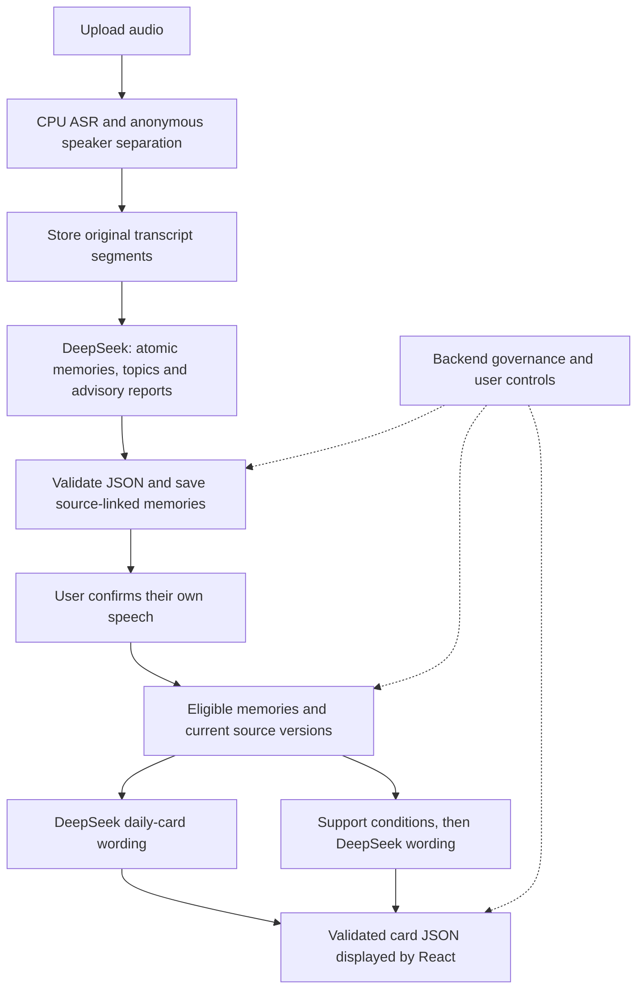

# Hear You Are

An audio-first memory and wellbeing support demo. Hear You Are turns recordings into source-linked memories, editable topics and daily cards, then offers support when explicit conditions and user preferences allow it.

**Current implementation: 18 October 2026.** React and TypeScript frontend, FastAPI backend, SQLite storage, CPU speech recognition and DeepSeek text processing.


*The screenshot shows the current React interface with fictional demonstration data. It does not show a real user's recording or personal memories.*

## What it does

- **Import and transcribe:** upload WAV, MP3, M4A, FLAC, OGG, WEBM or MP4, up to 100 MiB and 20 minutes. Transcription, atomic-memory extraction and topic organization start automatically.
- **Separate speakers:** local diarization assigns anonymous speaker labels within each recording. You explicitly confirm which transcript segments are yours, using individual selection, topic selection or **Select all**.
- **Edit memories by topic:** numbered topics have an **Edit topic** action for their title, summary and linked atomic memories. Editing is available before speaker confirmation and preserves the original transcript.
- **Generate daily cards:** after speaker confirmation, the app automatically prepares **Today's mood**, **Today's social side** and **Worth remembering**, with links to their sources.
- **Provide proactive support:** **Reminder**, **Suggestion**, **Comfort** and **Warning** have separate preferences and trigger conditions. Each shows its display timing and provides **Edit display time** and **Display Proactive Support Now**.
- **Keep corrections traceable:** source references, memory versions and output dependencies let edits or deletion invalidate affected cards. Retention and deletion are enforced by the backend.

Dates displayed as **Uploading date** use the server's upload timestamp, shown in Hong Kong time (UTC+8). They are not the original event or recording date. There is no separate **Review AI interpretation** approval step; speaker confirmation remains required before attributing speech to the user.

## Five memory layers

The layers share audio files and a SQLite database. They are logical responsibilities, not five independent services.

1. **Raw evidence:** preserve the uploaded audio, transcript, estimated segment times and anonymous speaker labels. Speech runs through **SenseVoiceSmall INT8**, **Silero VAD** and **Sherpa-ONNX diarization** on the app host's CPU.
2. **Atomic memories:** a DeepSeek prompt extracts individual events, expressed feelings and explicitly stated preferences as JSON. The backend validates each quotation against its cited transcript segment and assigns IDs and versions. Unconfirmed speech produces tentative memories.
3. **Consolidation:** DeepSeek proposes duplicates or conflicts and separately organizes consecutive transcript segments into topics. Topic groups are validated and saved. Duplicate/conflict proposals remain advisory; actual deduplication, version history and user corrections are backend operations.
4. **Retrieval and context:** backend filters select eligible sources; DeepSeek can rank supplied memory IDs for searches. Import-time ranking is recorded in the processing report. Daily cards instead gather eligible memories for the selected day and generate a separate, source-linked summary.
5. **Governance:** a DeepSeek prompt produces advisory review suggestions. Backend rules enforce identity confirmation, permissions, preferences, retention, deletion and source-version checks throughout the flow.



The four required text stages use server-side DeepSeek prompts and strict JSON validators. Their advisory reports do not automatically merge into a new memory set between calls. Daily summaries and support wording use additional prompts. Automatic semantic merging across days and a vector database are not implemented. See [Memory pipeline](docs/MEMORY-PIPELINE.md) for contracts, prompt locations and retry behavior.

## When proactive support appears

- **Reminder:** an explicitly permitted, unfinished follow-up has reached its due time.
- **Suggestion:** a supported practical-help request or the implemented repeated-poor-sleep pattern matches.
- **Comfort:** an explicit reassurance/support request or a supported emotional/social follow-up matches.
- **Warning:** confirmed, current words express strong distress today, or the same emotional/social distress topic appears on at least three distinct days within seven days, including today. Real recordings can trigger it; fictional demo data is not required.

Warning uses bounded English/Chinese source-word rules, rather than vocal emotion or a generated paraphrase. It shows its evidence and **Why this warning**. Negated, reported, hypothetical, withdrawn or explicitly improved statements are excluded by the implemented rules. These conditions are application rules for supportive check-ins, not medical diagnoses or clinical thresholds.

Matching a condition is separate from delivery. Preferences, source confirmation, current evidence, quiet mode, cooldown, feedback and scheduling can affect automatic display. A real Warning has priority in automatic type selection. **Display Proactive Support Now** explicitly selects a type and bypasses delivery scheduling; it still requires eligible evidence and permission. Saved display times are one-off targets, evaluated while the application is active. OS push notifications are not implemented.

## Run locally on Windows

Install **Python 3.11+** and **Node.js 22.12+ or 24**. Node.js 24 is used by CI. No GPU, Docker or speech API account is required for local CPU inference.

```powershell
git clone https://github.com/macaqueedmai-wq/Hear-You-Are---Software---Demo.git
cd Hear-You-Are---Software---Demo
python scripts/setup.py --download-models
Copy-Item .env.example .env
```

The setup script creates `.venv`, installs `requirements-sensevoice.txt`, downloads ASR/VAD/diarization models and builds the frontend with `npm ci` and `npm run build`. Model download time depends on your connection. To download the models separately later:

```powershell
.\.venv\Scripts\python.exe scripts/download_sensevoice_models.py
```

Edit `.env` and fill in the four server-side keys:

```dotenv
HYA_DEEPSEEK_ATOMIC_API_KEY=your_key
HYA_DEEPSEEK_CONSOLIDATION_API_KEY=your_key
HYA_DEEPSEEK_RETRIEVAL_API_KEY=your_key
HYA_DEEPSEEK_GOVERNANCE_API_KEY=your_key
```

Keep the example's `HYA_ASR_PROVIDER=sensevoice`, `HYA_MEMORY_MODE=deepseek`, official `https://api.deepseek.com` endpoint and configured `deepseek-flash` model, or choose a model available to your account. The optional raw-evidence key is for a text-quality review after ASR and can remain empty. By default, daily cards and support reuse the retrieval key. Never put keys in frontend code or commit `.env`.

Start the app:

```powershell
.\.venv\Scripts\python.exe scripts/run.py --open
```

Open **http://127.0.0.1:8765** and keep the terminal running. Press Ctrl+C to stop. `Start-Demo.cmd` provides the same local launch after setup. On Linux/macOS, use `.venv/bin/python` in place of the Windows Python path. `run.py` serves the built frontend; it does not install dependencies or build missing assets.

Upload a short recording, inspect or edit the numbered topics, then confirm only the speech that belongs to you. Daily cards update automatically. Open **Proactive AI** to see which conditions match and what is holding back delivery. Missing models, invalid credentials and failed model requests are reported rather than replaced with fabricated transcription or summaries.

## Development and checks

Install development dependencies and run the backend tests:

```powershell
.\.venv\Scripts\python.exe -m pip install -r requirements-dev.txt
.\.venv\Scripts\python.exe -m pytest -q
```

Build the frontend and run its helper tests:

```powershell
cd web
npm ci
npm test
npm run build
```

For development, run `npm run dev` from `web/` and the backend from the repository root with `.venv\Scripts\python.exe -m uvicorn backend.hya.app:app --host 127.0.0.1 --port 8765 --reload`. Vite proxies `/api` to port 8765.

To reproduce the English UI screenshot after building the frontend, run `.venv\Scripts\python.exe scripts/preview_readme.py` and open **http://127.0.0.1:8766**. This preview uses fictional English transcript fixtures and local summaries in disposable storage. It needs no recordings, model downloads or API keys, and does not open the normal app database. Stop it with Ctrl+C.

Optional model checks use synthetic fixtures: `scripts/verify_sensevoice_asr.py --run`, `scripts/verify_deepseek.py` and `scripts/verify_real_warning.py --live-model`. The latter two make billable DeepSeek requests; the speech check also does so if `--with-deepseek` is supplied. Synthetic checks do not establish real-conversation accuracy, overlap accuracy or production capacity.

## Data, deployment and source map

Audio is processed on the app host: your computer for a local run, or the server for a hosted deployment. Transcript text and relevant memories are sent to the configured DeepSeek API. This is not a fully offline application. Diarization labels are anonymous and recording-scoped; they do not identify people across recordings. Segment times are estimates; word-level timestamps are unavailable.

Local audio is stored under `data/audio/`, with memories, sources, versions and dependencies in SQLite. Credentials, recordings, databases, model weights and local verification artifacts are excluded from Git. The optional dataset importer stores examples for later review; it does not automatically train a model or use them for live psychological judgments.

- [`web/src/`](web/src/): React UI, topic editing, source selection and support controls.
- [`backend/hya/`](backend/hya/): FastAPI routes, speech adapters, prompts, validators, storage and support rules.
- [`tests/`](tests/) and [`web/tests/`](web/tests/): backend and frontend behavioral checks.
- [`scripts/`](scripts/): setup, model downloads, launch and synthetic verification.
- [Memory pipeline](docs/MEMORY-PIPELINE.md): data contracts and model configuration.
- [Cloud deployment](docs/CLOUD-DEPLOYMENT.md): Docker/Caddy deployment, authentication, storage and dated release records.
- [UI source](docs/UI-SOURCE.md): attribution for the adapted MoodHaven interface.

The [hosted demo](https://hear-you-are.43-161-239-58.sslip.io/) requires login. Credentials are not published in this repository. Consult the deployment guide before exposing a separate installation publicly.

## License

Project code is released under [MIT](LICENSE). Adapted MoodHaven components retain their upstream MIT attribution; see [third-party notices](THIRD-PARTY-NOTICES.md). Model weights have separate terms: SenseVoice uses the FunASR Model Open Source License, while diarization assets and runtime components have their own licenses. See [model sources and licensing](docs/MEMORY-PIPELINE.md#provider-configuration) before redistributing weights.
