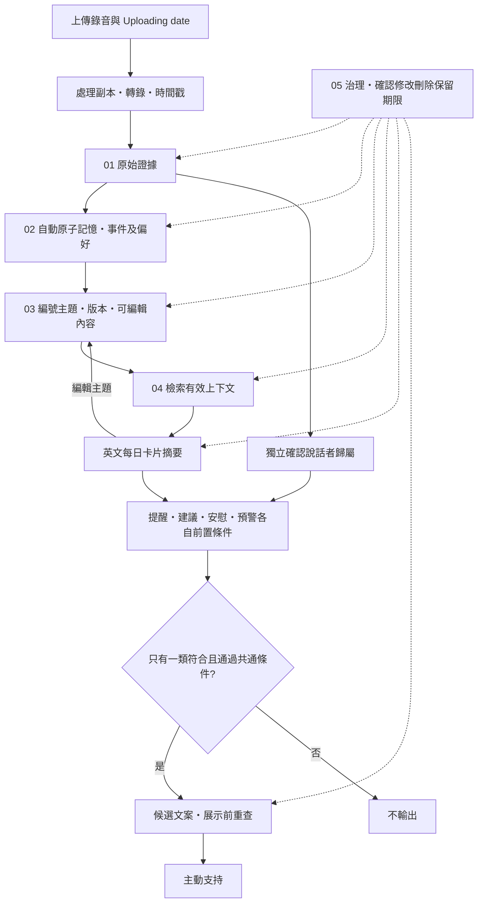

# Hear You Are · 軟件 Demo

**v0.2.0 · 2026-10-13 · Yonghan（with Codex）**

將上傳錄音自動整理成可追溯、可修改的原子記憶、主題及每日摘要，再按說話者歸屬、使用者偏好與條件提供主動支持。使用 MoodHaven 介面及五層 Memory Infra。

**目前工作流程已更新，最新雲端發布狀態以部署記錄為準。** 日期統一顯示 **Uploading date**，由伺服器上傳時的 `created_at` 決定；不再填寫或修改錄音發生時間，也不再要求逐張核准 AI 理解。以下較早的部署／驗證紀錄保留為歷史證據，其中手動日期及理解核實流程已被本政策取代。

**2026-10-18 已部署：SenseVoiceSmall INT8＋主機說話者分群＋DeepSeek 官方 API。** 現有騰訊香港 4vCPU／8GB CPU 主機已更新為 Sherpa-ONNX 的 [SenseVoiceSmall INT8](https://k2-fsa.github.io/sherpa/onnx/sense-voice/pretrained.html)，配合 Silero VAD、pyannote segmentation 3.0 及 CAM++ 中英語音嵌入模型。這條 CPU 路徑不需 Torch、CUDA、強制對齊模型或語音 API 金鑰。主機候選映像以 25.75 秒合成英文 A／B／A 雙聲音實測：完整 VAD、分群及轉錄耗時 4.338 秒，程序峰值工作集 472.3 MiB，產生 6 個片段及 2 個匿名群，A 返回時沿用同群，合成樣本 WER 為 0。四個 DeepSeek 階段及卡片 JSON 亦通過，產生 6 條記憶及 3 張待核實卡片。這是單一合成測試，不能代表真實對話準確度或持續容量。模型來源與授權見 [五層接口](docs/MEMORY-PIPELINE.md)。

後四層仍直接呼叫 `https://api.deepseek.com` 的 `deepseek-flash`，驗證 JSON 後才寫入，四把官方金鑰分配給四個語義階段。四把金鑰均通過官方模型列表驗證（HTTP 200），並完成先前的合成文字生成與來源／JSON 合約檢查。**語音在本機／主機處理，不代表整套系統離線：逐字稿與相關記憶仍會傳給 DeepSeek。**

受密碼保護的示範網址為 **https://hear-you-are.43-161-239-58.sslip.io**，沿用原有帳密與 HTTPS。更新透過既有騰訊 TAT 控制台連線完成；舊原始碼及停機資料快照均已保留。外部 HTTPS 已驗證未登入回應 401、登入後 API／首頁／JS／CSS 回應 200。用戶登入後，Chrome 已確認每日卡片、偏好設定及匯入錄音頁面可開啟，顯示主機 CPU、SenseVoiceSmall INT8、匿名說話者標籤及 DeepSeek 配置；這次只讀檢查沒有上傳或新轉錄。較大的 Qwen／GPU 方案已停止本輪下載，僅保留為未配置的可選程式。先前騰訊 ASR 路徑已停止，後付費及訓練資料同意保持關閉。詳見 [雲端部署](docs/CLOUD-DEPLOYMENT.md)。


## 這版可以做甚麼

- 上傳 WAV／MP3／M4A／FLAC／OGG／WEBM／MP4 後自動執行 **Transcribing → Atomic memories → Topics**；無須額外點擊 Process。僅失敗時提供重試；上限為 100 MiB／20 分鐘。
- **Uploading date** 採伺服器上傳時間並以香港時區顯示；不是實際事件發生時間，沒有手動日期輸入或修改入口。
- **Atomic memories** 按 1、2、3… 主題編號展示，每個主題都有 **Edit topic**，可一併修改標題、摘要與所屬原子記憶；說話者尚未確認時亦可編輯。衝突時保留輸入並要求明確重新保存，原音及原話不變。
- 逐字稿保留原話與可展開的時間片段；支援選取整個話題、三態 **Select all**、清除選取及個別微調。只有明確點擊 **Confirm N segments as mine** 才確認說話者歸屬；編輯主題不會代為確認身分或變更許可。
- 保留錄音原件及英文逐字稿。Silero VAD／說話者時間段提供估計片段邊界，**此路徑不提供詞級時間戳**。本機分群組件產生同一錄音內的匿名 `Speaker 0`／`Speaker 1` 標籤；它們不代表用戶身分。重疊或無法匹配的聲音保持未知，時間及標籤應對照原音核查後再確認歸屬。
- 每日摘要依 Uploading date 展示心情、社交及重要片刻，提供 **Sources／Edit topic**；不再要求點擊 That's right 或逐張核准理解。
- 修正建立新版本並更新卡片；刪除記憶清除其歷史文案及衍生提示；刪除錄音一併移除片段、關聯記憶與原檔。相同檔案重複匯入不增加證據。
- 提醒、建議、安慰各有明確前置條件；零類符合、條件不明、多類符合而優先規則未定時不輸出。展示前重查來源版本、許可、免打擾及頻率。
- 主動支持自動連結可用的過往與今天記錄，仍受說話者歸屬、偏好、許可與各類條件限制；不以 AI 理解核准作為前置門檻。睡眠建議可讓用戶明確選擇睡覺提醒時間，應用開啟時檢查到期事項。
- 提供略過、延後、完成、幫助回饋；接收狀態不當成新個人事實。
- 偏好內保留專業知識／心理諮詢案例 JSONL 資料集入口：本機匯入、查看、去重、刪除，均為待專業審核；未啟動後訓練，也未投入即時心理判斷。
- 所有介面文案及摘要採英文，原始英文逐字稿保留英文。

## 在 Windows 啟動

需要 **Python 3.11+** 及 **Node.js 20.19+／22.12+**。CPU 路徑使用 `.venv`；本機合成雙聲音測試在 Windows／Python 3.13 完成，雲端候選映像使用 Linux／Python 3.12。不要使用未完成的 Qwen `.venv-asr` 環境。

```powershell
git clone https://github.com/macaqueedmai-wq/Hear-You-Are---Software---Demo.git
cd Hear-You-Are---Software---Demo
python -m venv .venv
.\.venv\Scripts\python.exe -m pip install --upgrade pip
.\.venv\Scripts\python.exe -m pip install -r requirements-sensevoice.txt
.\.venv\Scripts\python.exe scripts/download_sensevoice_models.py
```

複製 `.env.example` 至 `.env`，設定 DeepSeek 模型 ID 與四個語義階段金鑰。範例已啟用 `HYA_ASR_PROVIDER=sensevoice`，模型路徑對應下載指令產生的 `models/sensevoice/` 及 `models/diarization/`。改變下載位置時才需修改路徑。ASR、VAD 及說話者分群均為必要組件；缺少模型或依賴時會顯示未就緒。

推理只讀取本機權重，不會因匯入錄音而自動下載。SenseVoice 預設 4 執行緒、最長 30 秒辨識視窗；說話者分群預設 2 執行緒、聚類閾值 0.5。更換硬體、錄音長度或並發量後，應重新測量整體延遲與記憶體。

本機啟動時，語音在本機處理；雲端部署時，錄音會上傳到該主機並在主機處理。逐字稿及記憶文字仍會傳到 DeepSeek 官方 API；若明確改用 A2Agent 等中轉服務，相關文字才會傳到該第三方端點。金鑰不進前端或部署原始碼壓縮檔。

完成後雙擊 **Start-Demo.cmd**，或：

```powershell
.\.venv\Scripts\python.exe scripts/run.py --open
```

瀏覽器開啟 **http://127.0.0.1:8765**。保持終端運行；按 Ctrl+C 停止。服務未配置或模型權限不足時會顯示具體錯誤，不會換模型或偽造逐字稿。

其他作業系統可在建立相應 CPU 環境後執行 `.venv/bin/python scripts/run.py`。原始碼無需 Docker、雲端資料庫或桌面安裝包。

## 使用路徑

1. 上傳短英文錄音，伺服器自動指定 Uploading date 並執行轉錄、原子記憶與主題整理。
2. 在 Atomic memories 按編號主題查看內容，用 Edit topic 修改標題、摘要及原子記憶；到原始片段回放並確認哪些聲音屬於自己。
3. 每日摘要及主動支持自動更新；可查看來源或編輯內容，不需要額外核准 AI 理解。主動式 AI 頁列出提醒、建議或安慰的條件，並受偏好、許可及頻率限制。
4. 睡眠建議可設定未來的睡覺提醒時間；應用開啟時檢查到期事項。
5. 偏好→專業資料集入口，可使用 [虛構格式範例](docs/dataset-example.jsonl) 測試匯入。所有資料留在本機 `data/`，不會上傳 GitHub 或自動投入訓練。

真正匯入後才執行配置的 VAD、轉錄及說話者分群。匿名標籤只區分同一錄音內的聲音，不自動辨認哪個人是用戶，也不跨錄音建立身分。只確認確定屬於本人的片段；重疊或混合他人聲音的片段保持未確認。

## 文字分析及模型文案

預設 `HYA_MEMORY_MODE=deepseek`：逐字稿先保存為來源，再分別執行原子記憶、整合建議、檢索排序與治理核查。四把官方金鑰依序分配給 `ATOMIC`、`CONSOLIDATION`、`RETRIEVAL`、`GOVERNANCE`；可選的 `RAW_EVIDENCE` 額外文字品質檢查預設不配置，不影響四個必要階段。所有輸出都需符合 JSON 合約；模型不能設定確認狀態、同意、刪除或提醒許可。

上傳後自動呼叫 DeepSeek，既有逐字稿亦可由後端整理成主題，不必重新轉錄。主題是持久化的 `recording.topics`；使用者編輯後不會因暫時的分析狀態失效而消失。模型失敗會保留原始證據並顯示重試；DeepSeek 模式不會把本機模板偽稱模型結果。合併／衝突及治理輸出仍是建議，不能自行改變身分、刪除或許可。

完整設定、提示詞位置、JSON 槽位、測試及資料流見 [MEMORY-PIPELINE.md](docs/MEMORY-PIPELINE.md)。所有真實金鑰只放在被忽略的 `.env`；雲端配置使用 `deploy/.env`，不提交至 Git 或映像檔。

## 五層 Memory Infra



原始檔在 `data/audio/`；工作副本用完即移除。SQLite 保存來源片段、記憶、版本、卡片依賴及關懷接收狀態。記憶整合目前採去重、版本歷史及人工修正；跨日自動語義衝突合併屬後續功能。治理是貫穿各層的能力，不是最後才執行的步驟。

## 開發及驗證

目前前端自動流程／主題編輯版本通過 production build 與 32 項 helper 測試。以下日期化部署與驗證段落保留為歷史記錄；其中手動錄音日期、That's right 與理解核准門檻已被目前政策取代，不能作為新版本已部署的證明。

```powershell
.\.venv\Scripts\python.exe -m pytest -q
cd web
npm ci
npm run build
```

前端開發：`npm run dev`，Vite 把 `/api` 代理到 8765。CPU 後端：`.venv\Scripts\python.exe -m uvicorn backend.hya.app:app --host 127.0.0.1 --port 8765 --reload`。

`scripts/verify_asr.py` 及 [ASR 驗證](docs/ASR-VERIFICATION.md) 記錄的是舊版本機 Whisper 測試，需要可選開發依賴；不能取代目前 SenseVoice 的驗證記錄。[MVP 驗收](docs/MVP-VERIFICATION.md) 亦屬先前版本紀錄。新版服務的實際驗收步驟見 [雲端部署](docs/CLOUD-DEPLOYMENT.md)。

官方 DeepSeek 的合成文字檢查可用下列指令重現，會產生實際 API 用量及費用；請先配置 `.env`。它只使用合成文字和暫存資料庫，不讀取實際應用資料、錄音或音訊，也不呼叫 ASR：

```powershell
.\.venv\Scripts\python.exe scripts/verify_deepseek.py
```

2026-10-18 的通過記錄為 `artifacts/private/deepseek-live-20261018-173349.json`；該私有本機驗證記錄不納入 Git 或部署壓縮檔。語義理解核實仍由使用者完成。

本機 CPU 合成雙聲音通過記錄為 `artifacts/private/sensevoice-asr-20261018-102728.json`；使用 ASR／VAD／分群執行緒 4／4／2，無 GPU、外部 ASR 或真實應用資料。以下指令會生成 Windows 離線語音並執行完整本機語音流程；不加 `--run` 只生成檔案。`--with-deepseek` 會額外呼叫付費文字 API；同一合成錄音串接後四個語義階段已通過，記錄為 `artifacts/private/sensevoice-asr-20261018-102904.json`，可選原始文字品質階段跳過。這次串接檢查未另外生成卡片；上面的卡片 JSON 驗證來自獨立合成文字測試。

```powershell
.\.venv\Scripts\python.exe scripts/verify_sensevoice_asr.py --run
```

首次 SenseVoice 雲端候選映像已在同一 25.75 秒合成錄音上完成語音到卡片流程，整體檢查耗時 13.656 秒；只有隔離 `/tmp` 資料庫中的合成來源模擬身分確認，語義理解仍待核實，沒有讀取正式應用資料。正式 app 已重建並健康，該次外部 HTTPS 記錄為 `artifacts/cloud-deploy/sensevoice-external-verification-20261018.json`。

後續主題分組／全選更新亦已部署。本機合成文字以 8.703 秒將 6 個原始片段分成 2 個主題（各 3 片段），來源文字、未確認身分及未核實理解均保留；雲端候選檢查以 6.39 秒通過，這項檢查沒有重跑 ASR。該主題版本通過 534 項 Python 測試（42.15 秒）、19 項前端分組／選取測試、production build 及 `pip check`。外部 HTTPS 與新版 JS 通過記錄為 `artifacts/cloud-deploy/topics-external-verification-20261018.json`。雲端 UI 另以既有合成錄音的 4 個片段驗證為 2 個主題（各 2 片段）：處理中保留原文並停用選取；完成後全選 4/4、取消單片段至 3/4 的半選狀態、清空、單主題 2/4 及再次全選均通過，最後恢復 0/4。沒有新上傳、ASR、身分確認或理解核實；截圖為 `artifacts/cloud-deploy/topics-selection-verified-20261018.jpg` 及 `topics-review-ready-20261018.jpg`。

錄音日期／理解核實更新已部署並健康：578 項 Python 測試（34.30 秒）、34 項前端 helper 測試、production build、`pip check` 及 npm production audit（0 項漏洞）通過。隔離合成測試確認香港時間轉換、日期編輯衝突保護、無變更保存、先生成摘要才可核實，以及改日期後取消舊核實；未呼叫 ASR／外部模型，也未使用正式應用資料。記錄為 `artifacts/cloud-deploy/dates-local-verification-20261018.json`，雲端 HTTPS／新版資產檢查為 `dates-external-verification-20261018.json`。日期已透過實際 UI 保存，原始證據及說話者確認保持不變；3 張 AI 理解卡片已生成，等待使用者選擇 **That's right** 或 **Needs changes**，尚未提交理解核實或來源修改。錄音時間、內容及卡片截圖僅存於私有記錄。

用戶登入後的瀏覽器導覽驗證截圖為 `artifacts/cloud-deploy/sensevoice-browser-verified-20261018.jpg`；錄音匯入按鈕在未選檔時維持停用，未執行新上傳／轉錄。單一合成樣本仍不能驗證真實多人對話、重疊語音或持續雲端容量。SenseVoice 不識別個人身分。舊的 [`scripts/verify_tencent_asr.py`](scripts/verify_tencent_asr.py) 屬已停止的接入紀錄，不能作為目前語音流程的驗收證明。

## 原始碼與授權

- `web/`：React、TypeScript、Vite 的淺紫色介面。
- `backend/hya/`：FastAPI、ASR、SQLite Memory Infra、條件規則及可選文字模型。
- `tests/`：來源、主體確認、版本、刪除、條件、API 及模型輸出驗證。
- `scripts/`：設定、啟動、合成錄音驗證。
- `third_party/moodhaven/`：實際改造的上游元件快照與完整 MIT 授權；[元件映射](docs/UI-SOURCE.md)。

本項目採 MIT；第三方權利見 [THIRD-PARTY-NOTICES.md](THIRD-PARTY-NOTICES.md)。`.env`、錄音、模型、資料庫與本機執行報告均由 Git 忽略。

## 改動記錄

- **v0.2.0 · 2026-10-13**：分開主體確認及理解核實；加入歷史與當前的主動支持、睡覺提醒設定、英文摘要及後訓練資料集入口。
- **v0.1.0 · 2026-10-13**：首個可運行 MVP；真實本機 Whisper、五層記憶、卡片來源／修正、條件式關懷、演示資料、設定及驗收測試。
