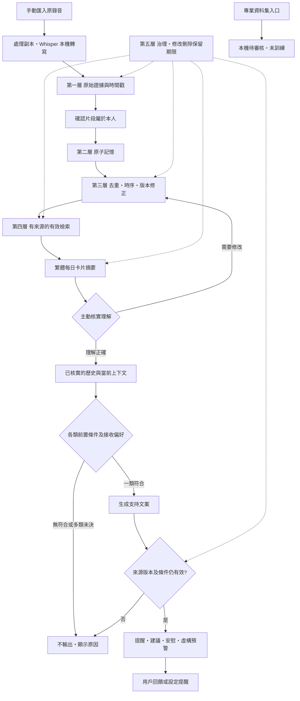
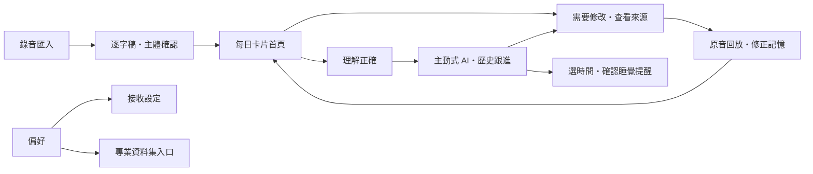

# 主動式 AI · MVP 規格

版本：v0.2.0　日期：2026-10-13　撰寫：Yonghan（with Codex）

## 一、先主動核實理解

錄音轉寫後，先確認哪些片段屬於本人，再生成每日心情、社交及重要片刻摘要。卡片主動詢問：「這些事情有發生嗎？我有理解對你嗎？需要怎樣修改？」

使用者可以確認整張卡片，或進入來源修改個別記憶。確認會核對摘要 token、完整來源與版本；處理期間來源改變時回報版本衝突。修改不覆寫錄音或原始逐字稿；新摘要需要再核實。

## 二、再主動提供支持

只有屬於本人、已核實、有效且有來源的記憶可以作支持依據。除現有明確需求之外，增加三種歷史跟進：

- **睡眠跟進**：最近七天三個不同日期，包含今天，都明確表述睡眠不足，才提供休息建議及詢問是否設定睡覺提醒。這是 MVP 展示持續表述的規則，不是疾病或醫療風險門檻。
- **社交跟進**：過往記錄明確提及孤單或社交困難，今天明確提及與朋友交談後感覺好些，才連結兩次記錄作鼓勵。
- **情緒跟進**：過往與今天明確表述壓力，而且今天要求支持，才給出連結歷史的安慰。

每張支持卡保留歷史與當前來源、時間及版本。偏好、免打擾、延後、頻率、單類輸出及展示前重查同時適用。零類符合或多類符合而優先規則未定時不展示。

睡覺提醒要由使用者選擇未來時間並確認設定才建立，不從錄音擅自推定授權。提醒在應用開啟時檢查到期；目前沒有作業系統通知、背景排程或重複鬧鐘。

## 三、心理健康資料集入口

偏好中的 JSONL 入口可保存心理健康知識、心理諮詢案例或支援指引。每筆必須有來源、授權、去識別及可使用同意聲明。檔案上限 5 MB、1000 筆。

匯入後一律標記「待專業審核」，不自動啟動後訓練、不加入即時推理，也不據此判斷用戶心理健康。格式範例明確是虛構資料。真正的專業資料、專業審核、訓練管道和評估留待後期；目前警示只驗證清楚標示的虛構流程。

## 四、全鏈路流程

## 五、介面跳轉

改動記錄：v0.2.0 增加主動核實、歷史支持及資料集入口；四類提示仍須先通過各自條件。
